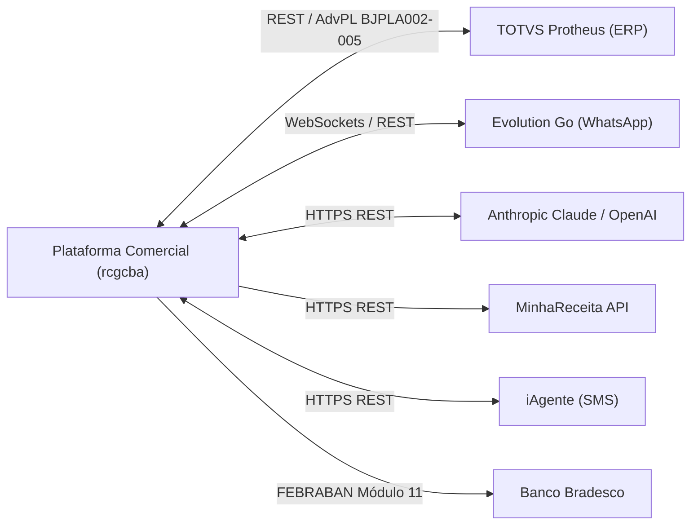

# Arquitetura Geral do Sistema — rcgcba

> Visão executiva consolidada da arquitetura da plataforma comercial multi-tenant.
> Nível de documentação: **detalhado**.
> Escala de confiança: 🟢 CONFIRMADO (código, banco, infra e docker) · 🟡 INFERIDO · 🔴 LACUNA

---

## 1. Visão Executiva

A plataforma **rcgcba** é uma solução de gestão comercial, CRM omnichannel e força de vendas (B2B) operando no modelo SaaS multi-tenant. O sistema foi concebido para empresas distribuidoras e indústrias que utilizam ERPs de grande porte (como o TOTVS Protheus) como retaguarda fiscal/contábil, mas necessitam de uma camada moderna, ágil e em tempo real para equipes comerciais externas, vendedores em campo, gestores e clientes finais.

---

## 2. Padrões Arquiteturais Centrais 🟢

### 2.1 Multi-Tenancy com Isolamento em Banco (PostgreSQL RLS)
- O isolamento entre diferentes empresas contratantes é garantido na camada de dados via **Row-Level Security (RLS)** nativa do PostgreSQL.
- Todas as tabelas de negócio possuem a coluna `empresaId`. Cada transação da aplicação define `app.current_empresa_id`, impedindo qualquer vazamento de dados, mesmo em queries manuais ou operações de analytics.

### 2.2 Monorepo com Turborepo e pnpm Workspaces
- Organizado em monorepo com pacotes isolados:
  - `apps/api`: Backend NestJS 11 modular.
  - `apps/web`: Frontend Next.js 16 (App Router) + React 19 + Tailwind CSS v4.
  - `apps/portal-cliente`: Portal B2B de autoatendimento.
  - `apps/whatsapp-worker`: Worker de filas para mensageria assíncrona.
  - `packages/contracts`: Biblioteca única de schemas Zod e DTOs tipados compartilhados de ponta a ponta entre front e back.

### 2.3 Renderização sob Demanda vs. Armazenamento Estático
- **Zero PDFs estáticos:** 2ª via de DANFE é gerada instantaneamente em memória a partir do XML autorizado da NF-e; 2ª via de boletos bancários é calculada sob demanda com instruções atualizadas e algoritmo FEBRABAN Módulo 11.

### 2.4 Inteligência Artificial Integrada via RAG com pgvector
- O banco de dados PostgreSQL incorpora a extensão `pgvector`, permitindo armazenamento de embeddings e busca por similaridade semântica de cosseno nas fichas técnicas de produtos, abastecendo o assistente virtual do WhatsApp com respostas técnicas fidedignas.

---

## 3. Decomposição de Módulos e Subsistemas 🟢

O sistema divide-se em 6 macrodomínios funcionais:

1. **Acessos, Governança & Multi-Tenant:**
   - Gestão de empresas, grupos econômicos, usuários, perfis por grupo, sessões únicas por usuário e rotação de refresh tokens.
2. **Comercial & Carteiras:**
   - Clientes, contatos, titularidade, Posição de Cliente 360°, fila de aprovação cadastral, gestão de equipamentos em comodato e alerta de comodato sem consumo.
3. **Catálogo & Precificação:**
   - Produtos, categorias com controle de acompanhamento (`usado`), tabelas de preço, regras de desconto por faixa e busca vetorial de fichas técnicas.
4. **Vendas & Faturamento:**
   - Orçamentos comerciais, notas fiscais de saída (corte analítico de vendas), geração de DANFE e títulos a receber com boletos bancários.
5. **Omnichannel & CRM:**
   - WhatsApp corporativo pareado via Evolution Engine, triagem inteligente por carteira, agendamentos, tarefas de CRM e funil de oportunidades/leads.
6. **Integração ERP:**
   - Endpoints públicos REST autenticados por `x-api-key`, monitoramento de cargas batch e sincronização com rotinas AdvPL do Protheus.

---

## 4. Mapa de Integrações Externas 🟢

---

## 5. Dívidas Técnicas Identificadas 🟡

1. **Testes Unitários em Módulos Operacionais:**
   - Módulos críticos como `comunicados.service`, gerador de XML de demonstração e controllers de faturamento possuem cobertura parcial ou inexistente de testes unitários.
2. **Cache de Consultas de Alta Frequência:**
   - O endpoint de status de integração (`/inicio/status-integracao`) é consultado via polling a cada 30 segundos pelos navegadores e executa até 6 queries de fallback paralelas quando a chave de API não grava timestamps. Um cache de 30s no Redis eliminaria esse gargalo.
3. **Versionamento e Aceite de Termos Internos da Empresa:**
   - Enquanto os Termos de Uso da Plataforma possuem controle estrito de versões e tabela de aceites com hash SHA-256, os regulamentos internos da empresa (`empresas.termosUso`) ainda operam como texto livre sem histórico de versão nem obrigatoriedade de confirmação pelo colaborador.

---

## 6. Referência aos Diagramas de Detalhe

- **C4 Nível 1 (Contexto):** [`_reversa_sdd/c4-context.md`](file:///c:/VPS/rcg/_reversa_sdd/c4-context.md)
- **C4 Nível 2 (Containers):** [`_reversa_sdd/c4-containers.md`](file:///c:/VPS/rcg/_reversa_sdd/c4-containers.md)
- **C4 Nível 3 (Componentes da API):** [`_reversa_sdd/c4-components.md`](file:///c:/VPS/rcg/_reversa_sdd/c4-components.md)
- **ERD Completo de Dados:** [`_reversa_sdd/erd-complete.md`](file:///c:/VPS/rcg/_reversa_sdd/erd-complete.md)
- **Matriz de Impacto e Acoplamento:** [`_reversa_sdd/traceability/spec-impact-matrix.md`](file:///c:/VPS/rcg/_reversa_sdd/traceability/spec-impact-matrix.md)
- **Infraestrutura e Deployment:** [`_reversa_sdd/deployment.md`](file:///c:/VPS/rcg/_reversa_sdd/deployment.md)

