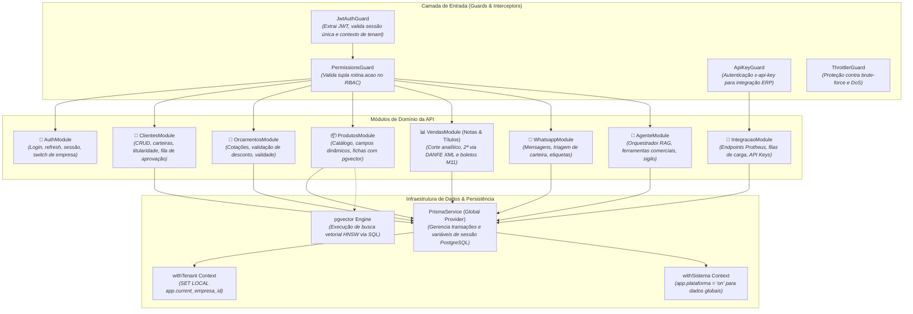

# Diagrama C4 — Nível 3: Componentes Internos da API Central

> Arquitetura modular interna do container NestJS (`apps/api`).
> Escala de confiança: 🟢 CONFIRMADO

---

### Componentes de Destaque da API 🟢

1. **`PrismaService` (`apps/api/src/common/prisma/prisma.service.ts`):**
   - O coração da arquitetura multi-tenant. Garante que nenhuma query de negócio execute sem tenant ativo. Injeta `app.current_empresa_id` em cada transação via `AsyncLocalStorage`.
2. **`VendaAnalitica` (`apps/api/src/common/vendas/venda-analitica.ts`):**
   - Centraliza o `corteDeVenda` compartilhado entre todos os módulos analíticos (dashboards, metas, WhatsApp).
3. **`EnriquecimentoService` & `MinhaReceita`:**
   - Consome API pública de dados da Receita Federal com normalização de CNAE e endereço para evitar divergências cadastrais.
4. **`DanfeService` & `BoletoService`:**
   - Motores de renderização dinâmica em PDF vetorial sob demanda, dispensando armazenamento de arquivos estáticos.

