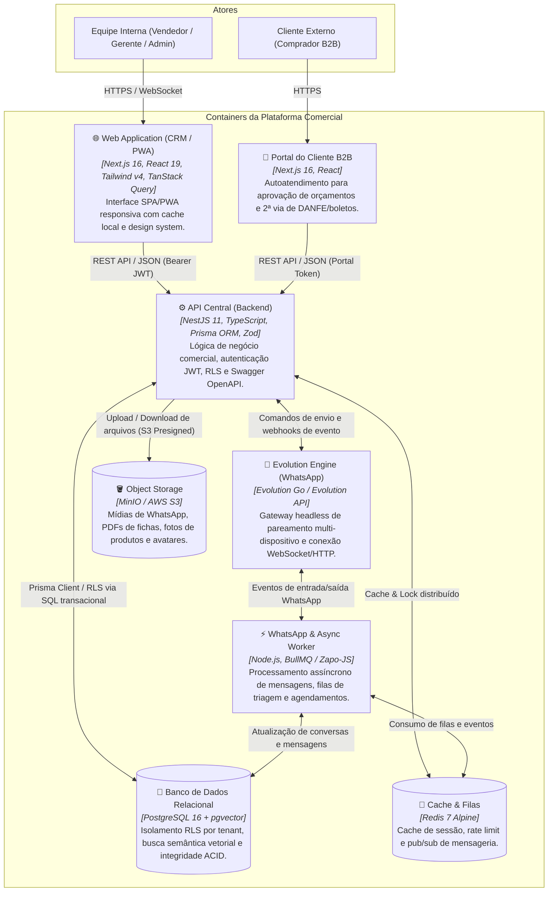

# Diagrama C4 — Nível 2: Containers do Sistema

> Decomposição em aplicações, bancos de dados, mensageria e storages.
> Escala de confiança: 🟢 CONFIRMADO

---

### Tabela de Tecnologias dos Containers 🟢

| Container | Stack Tecnológica | Porta Padrão | Responsabilidade |
|---|---|---|---|
| `web` | Next.js 16.2, React 19, Tailwind CSS v4 | `:3000` (mapeada `:3002`) | Interface rica para vendas, CRM, dashboards e gestão. |
| `portal-cliente` | Next.js 16, React | `:3003` | Interface pública simplificada de autoatendimento B2B. |
| `api` | NestJS 11, Prisma 6.2, TypeScript 5.9 | `:3001` | Core de regras de negócio, autorização RBAC e endpoints. |
| `whatsapp-worker` | Node.js 20, BullMQ, Zapo-JS | - (Worker) | Processamento em background de mensagens e campanhas. |
| `postgres` | PostgreSQL 16 + pgvector | `:5432` (mapeada `:5433`) | Persistência relacional multi-tenant com RLS nativa. |
| `redis` | Redis 7 Alpine | `:6379` | Cache de curto prazo, filas de execução e pub/sub. |
| `minio` | MinIO S3-Compatible Storage | `:9000` / `:9001` | Repositório de arquivos, fotos, mídias e backups. |
| `evolution-go` | Evolution Go Engine 0.7.2 | `:8080` (mapeada `:8081`) | Emulação e manutenção de sessões ativas do WhatsApp. |

