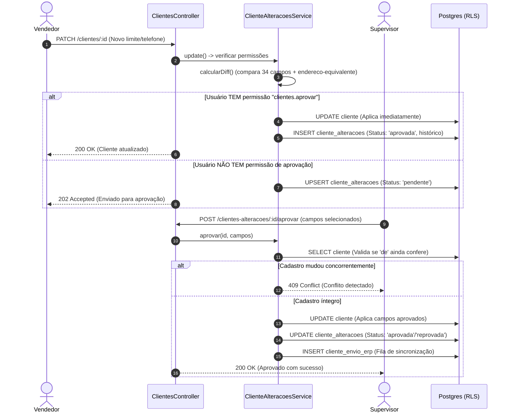

# clientes — Design Técnico

> Especificação de design técnico e arquitetura interna do módulo `clientes`.
> Escala de confiança: 🟢 CONFIRMADO (código) · 🟡 INFERIDO (arquitetura) · 🔴 LACUNA (requer validação)

## Interface

### Endpoints HTTP — `ClientesController` (`/clientes`)

| Método | Caminho | Entrada | Saída | Status Codes |
|--------|---------|---------|-------|--------------|
| `GET` | `/clientes` | `ClienteQueryDto` | `{ data: Cliente[], meta: PaginationMeta }` | 200, 401 |
| `GET` | `/clientes/vendedores-escopo` | `VendedoresEscopoQueryDto` | `VendedorOpcao[]` | 200, 401 |
| `GET` | `/clientes/municipios-escopo` | `MunicipiosEscopoQueryDto` | `string[]` | 200, 401 |
| `GET` | `/clientes/ufs-escopo` | `UfsEscopoQueryDto` | `string[]` | 200, 401 |
| `GET` | `/clientes/posicao` | `PosicaoClienteListQueryDto` | `{ data: PosicaoClienteItem[], total: number }` | 200, 401 |
| `GET` | `/clientes/consulta-cnpj/:cnpj` | Param: `cnpj` | `ConsultaCnpjDto` | 200, 404, 502 |
| `POST` | `/clientes/receita/lote` | `ClientesReceitaLoteBodyDto` | `{ execucaoId: string, total: number }` | 202, 409 |
| `GET` | `/clientes/receita/execucoes/ultima` | — | `ExecucaoReceitaDto \| null` | 200, 401 |
| `GET` | `/clientes/:id` | Param: `id` | `ClienteDetalheDto` | 200, 404 |
| `GET` | `/clientes/:id/posicao` | Param: `id` | `PosicaoClienteCompletaDto` | 200, 404 |
| `GET` | `/clientes/:id/mix` | Param: `id` | `MixProdutoItem[]` | 200, 404 |
| `GET` | `/clientes/:id/contatos` | Param: `id` | `ClienteContato[]` | 200, 404 |
| `POST` | `/clientes/:id/contatos` | Param: `id`, `ClienteContatoCreateDto` | `ClienteContato` | 201, 404 |
| `POST` | `/clientes` | `ClienteCreateDto` | `Cliente` | 201, 400 |
| `PATCH` | `/clientes/:id` | Param: `id`, `ClienteUpdateDto` | `Cliente \| ClienteAlteracao` | 200, 202, 404 |
| `POST` | `/clientes/:id/atualizar-receita`| Param: `id` | `{ atualizado: boolean, camposPendentes: string[] }` | 201, 404 |
| `GET` | `/clientes/:id/historico-alteracoes`| Param: `id` | `ClienteAlteracaoHistorico[]` | 200, 404 |
| `DELETE`| `/clientes/:id` | Param: `id` | `{ success: true }` | 200, 404, 409 |

### Endpoints HTTP — `ClienteAlteracoesController` (`/clientes-alteracoes`)

| Método | Caminho | Entrada | Saída | Status Codes |
|--------|---------|---------|-------|--------------|
| `GET` | `/clientes-alteracoes` | `ClienteAlteracaoQueryDto` | `{ data: ClienteAlteracao[], total: number }` | 200, 401 |
| `POST` | `/clientes-alteracoes/:id/aprovar` | Param: `id`, `ClienteAlteracaoAprovacaoDto?` | `ClienteAlteracao` | 200, 404, 409 |
| `POST` | `/clientes-alteracoes/:id/recusar` | Param: `id`, `ClienteAlteracaoRecusaDto` | `ClienteAlteracao` | 200, 400, 404 |

### Endpoints HTTP — Sub-coleções

| Método | Caminho | Entrada | Saída | Status Codes |
|--------|---------|---------|-------|--------------|
| `GET` | `/clientes/:clienteId/cnaes` | Param: `clienteId` | `ClienteCnae[]` | 200, 404 |
| `POST` | `/clientes/:clienteId/cnaes` | Param: `clienteId`, `ClienteCnaeCreateDto` | `ClienteCnae` | 201, 400, 404 |
| `POST` | `/clientes/:id/comodato-baixas` | Param: `id`, `ComodatoBaixaCriarDto` | `ComodatoBaixa` | 201, 400, 404 |
| `DELETE`| `/clientes/:id/comodato-baixas/:baixaId` | Params: `id`, `baixaId` | `ComodatoBaixa` | 200, 404 |

## Métodos e Funções Principais

| Símbolo | Assinatura | Retorno | Observação |
|---------|-----------|---------|------------|
| `ClientesService.posicao` | `(empresaId: string, user: AuthenticatedUser, id: string)` | `Promise<PosicaoCliente>` | Carrega notas ativas, comodatos, títulos e mix em paralelo |
| `ClientesService.listagemPosicao` | `(empresaId: string, user: AuthenticatedUser, query: PosicaoClienteListQueryDto)` | `Promise<ListResult>` | SQL puro (`Prisma.sql`) com ordenação de vendas 30/90 dias |
| `ClienteAlteracoesService.calcularDiff` | `(atual: Cliente, payload: any)` | `AlteracaoDiff` | Compara ~34 campos com normalização de endereço e texto |
| `ClienteAlteracoesService.aprovar` | `(empresaId: string, user: AuthenticatedUser, id: string, campos?: string[])` | `Promise<ClienteAlteracao>` | Aprova campo a campo; detecta concorrência via diff prévio |
| `ClientesReceitaLoteService.executar` | `(execucaoId: string, empresaId: string, user: AuthenticatedUser)` | `Promise<void>` | Loop em background com 1s de intervalo e auto-recuperação |
| `comodatoSemConsumoSql` | `(empresaId: string, diasSemConsumo: number)` | `Sql` | Expressão SQL descorrelacionada (`cliente.id IN (...)`) |

## Fluxo Principal — Posição de Cliente (`posicao`)

1. **Validação de Acesso e Escopo:**
   - Consulta o cliente por ID e `empresaId`.
   - Aplica `resolverEscopoVendedores(user)`: se o cliente tiver vendedor diferente da carteira do usuário, lança `NotFoundException` (404 deliberado). 🟢
2. **Carga Paralela de Entidades Agregadas (`Promise.all`):**
   - **Notas de Saída:** Busca notas fiscais ativas, tipo 'N', com condição de pagamento, excluindo notas de comodato (`comodato = false`).
   - **Comodatos:** Busca notas de saída marcadas como remessa de comodato e notas de retorno/devolução.
   - **Títulos a Receber:** Consulta títulos em aberto e liquidados, recalculando dias de atraso via calendário útil da empresa.
   - **Equipamentos em Comodato:** Executa subqueries de `comodato-sql.ts` calculando saldo líquido em poder do cliente e checando ausência de compras de aplicáveis nos últimos 30 dias.
   - **Mix de Produtos:** Agrupa histórico de itens comprados, calculando última data, preço pago e preço vigente na tabela do cliente.
   - **Atendimentos de WhatsApp:** Carrega histórico de mensagens e conversas vinculadas aos contatos do cliente. 🟢
3. **Consolidação:** Agrega KPIs de compras, totais em atraso e flags de bloqueio, retornando o objeto unificado. 🟢

## Fluxo de Fila de Alterações e Aprovação

## Dependências

- `PrismaService`: Persistência relacional com RLS por tenant e execução de queries complexas em `Prisma.sql`.
- `ClienteCampoConfigService`: Consulta das travas de campos cadastrais configuradas pela empresa.
- `ExternalHttpService`: Comunicação HTTP resiliente com a API pública da MinhaReceita.
- `AcessosService`: Registro de atividades e notificações de sistema para os vendedores.
- `TitulosReceberService` / `HorarioTrabalhoService`: Funções compartilhadas para cálculo de vencimento útil de títulos.

## Decisões de Design Identificadas

| Decisão | Evidência no Código | Confiança |
|---------|---------------------|-----------|
| **404 Deliberado para Escopo:** Resposta 404 em vez de 403 para clientes fora de carteira | `apps/api/src/modules/clientes/clientes.service.ts:235-237` | 🟢 |
| **SQL Puro na Listagem de Posição:** `Prisma.sql` para suportar `ORDER BY` em colunas calculadas | `apps/api/src/modules/clientes/clientes.service.ts:338-345` | 🟢 |
| **Otimização de Query de Comodato:** `IN (subquery descorrelacionada)` reduzindo tempo de 5.9s para <50ms | `apps/api/src/modules/clientes/comodato-sql.ts:50-55` | 🟢 |
| **Equivalência Fonética e Estrutural:** Normalização NFD e regex para abreviações de endereço | `apps/api/src/modules/clientes/endereco-equivalente.ts:1-75` | 🟢 |
| **Proteção contra Remoção de Dados do ERP:** Bloqueio de exclusão via API para clientes com `codigoErp` | `apps/api/src/modules/clientes/clientes.service.ts:369-371` | 🟢 |

## Estado Interno e Entidades

- **`clientes`:** Tabela principal contendo dados cadastrais, fiscais, endereço, limite de crédito, vendedor titular e flags de integração.
- **`cliente_alteracoes`:** Fila de propostas e auditoria histórica de alterações com JSONs de diff (`de` / `para`), autor, revisor e status.
- **`cliente_cnaes`:** Associação entre cliente e códigos CNAE da tabela de referência do IBGE com flag de atividade principal.
- **`comodato_baixas`:** Registro de baixas manuais de comodatos com data, motivo, autor e flag de desfazimento.
- **`clientes_receita_lotes`:** Registro de execuções de varredura cadastral em lote com contadores de progresso e falhas.

## Observabilidade

- Notificações de sistema emitidas ao aprovar/reprovar alterações cadastrais.
- Notificação automática disparada para o vendedor quando um cliente entra em sua carteira.
- Registro de auditoria gerado no histórico do cliente a cada aprovação ou baixa de comodato.
- Rastreamento de falhas consecutivas na integração MinhaReceita com interrupção automática aos 20 erros.

## Riscos e Lacunas

- 🟡 **Dependência de Serviço Público Externo:** A consulta à Receita depende da disponibilidade da MinhaReceita, que pode oscilar ou alterar limites de requisição sem aviso prévio. O sistema mitiga isso com tratamento 502 e rate limit de 1s no lote.
- 🟢 **Sincronização Bidirecional com ERP:** Alterações aprovadas são enviadas para a tabela de integração (`cliente_envio_erp`), dependendo da execução periódica do job AdvPL/API para gravação na SA1.

