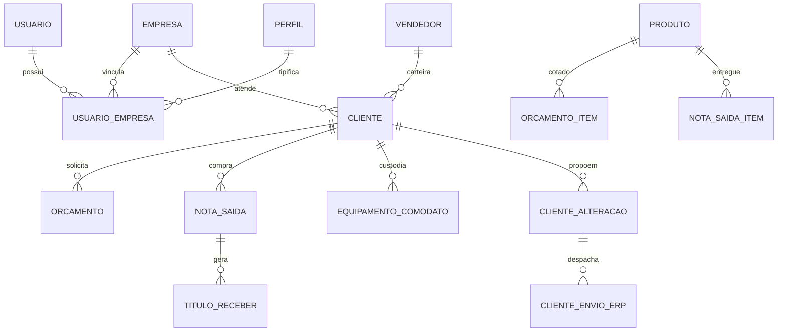

# Modelo de Domínio e Regras de Negócio — rcgcba

> Gerado pelo Detective. Nível de documentação: **detalhado**.
> Escala de confiança: 🟢 CONFIRMADO (código/docs/histórico) · 🟡 INFERIDO · 🔴 LACUNA

---

## 1. Glossário Ubíquo (Linguagem do Negócio) 🟢

| Termo | Significado no Domínio |
|---|---|
| **Empresa (Tenant)** | Unidade jurídica e operacional com isolamento estrito via PostgreSQL Row-Level Security (RLS). Possui CNPJ, razão social, parâmetros comerciais próprios e integrações. |
| **Grupo Econômico** | Agrupamento corporativo de uma ou mais empresas. Perfis de acesso, políticas de senha e assinaturas SaaS são governados no nível do grupo. |
| **Carteira de Clientes** | Conjunto de clientes vinculados a um vendedor. Define a visibilidade primária dos dados comerciais. |
| **Vínculo (`UsuarioEmpresa`)** | Relação de um usuário com uma empresa específica. Carrega o `perfilId`, hierarquia (`superiorId`), dados de vendedor e apelido. Não há tabela separada de "Colaborador". |
| **Corte de Venda** | Critério unificado que define o que é contabilizado como faturamento comercial nos dashboards e metas (exige duplicata mercantil gerada). |
| **Comodato** | Equipamento cedido a um cliente sem cobrança de compra (dispensers, dosadores), destinado a incentivar o consumo de insumos (químicos, papéis). |
| **Positivação** | Indicador de que um cliente realizou ao menos uma compra faturada com duplicata no período avaliado. |
| **Posição de Cliente** | Visão analítica 360° do cliente: histórico de compras, títulos em aberto/pagos, saldo de comodato, mix de produtos e notas fiscais. |
| **Titularidade** | Mecanismo de proteção de carteira: previne que vendedores prospectem ou cadastrem clientes que já pertencem à carteira de um colega. |
| **Fila de Alterações** | Fluxo de auditoria onde propostas de alteração cadastral de clientes (vindas de vendedores, da Receita Federal, de agentes de IA ou do ERP) aguardam aprovação humana. |
| **Sugestão de Compra** | Motor de recomendação baseado no ramo (CNAE) e histórico de consumo do cliente, identificando itens habituais não comprados recentemente. |
| **Agente de IA** | Assistente virtual comercial integrado ao WhatsApp corporativo, com permissões estritas para consulta de produtos, geração de orçamentos e consulta de pedidos. |

---

## 2. Regras de Negócio Fundamentais

### 2.1 Corte de Venda Analítica (`corteDeVenda`) 🟢

Dashboards Comercial e Gerencial, Metas/Objetivos, Consultas e ferramentas analíticas do WhatsApp utilizam estritamente o mesmo filtro centralizado (`venda-analitica.ts`):
1. **Geração de Duplicata:** A nota fiscal de saída deve ter gerado duplicata mercantil (`notas_saida.geraDuplicata = true`, originado de `F2_DUPL` do ERP). Se gerou, todos os itens da nota contam; se não gerou (ex.: remessas de comodato puras, bonificações, demonstrações e transferências), nenhum item entra no faturamento.
2. **Série Autorizada:** A série da nota fiscal deve constar no parâmetro comercial `VENDAS_SERIES_NOTA` (padrão `'1'`). Notas de RPS de serviço (série 3) geram duplicatas, mas são expurgadas por este filtro de série.
3. **Categoria Acompanhada:** O produto faturado deve pertencer a uma categoria com `categorias.usado = true`. Caso a categoria não esteja marcada como acompanhada, o item não soma no realizado daquele agrupamento.
4. **Exclusões Físicas:** A nota fiscal deve estar ativa (`deletedAt is null`, `ativo = true`), ser do tipo Normal (`tipo = 'N'`) e não possuir cabeçalho classificado como comodato puro.

### 2.2 Hierarquia Comercial e Escopo de Carteira 🟢

- **Isolamento de Carteira:** Toda consulta de clientes, pedidos, notas fiscais e títulos passa por `resolverEscopoVendedores`:
  - **Vendedor:** enxerga estritamente os clientes da sua própria carteira (`cliente.vendedorId == vendedor.id`).
  - **Supervisor / Gerente:** enxerga sua própria carteira mais a carteira de todos os vendedores subordinados direta ou indiretamente na hierarquia (`superiorId`).
  - **Administrador Empresa:** enxerga todos os clientes e movimentações de todas as carteiras da empresa.
- **Proteção 404:** Tentativas de acesso a clientes fora da carteira do vendedor retornam **HTTP 404** (Not Found), nunca 403, impedindo que o operador descubra a existência de clientes alheios por varredura de IDs.
- **Exceção de Titularidade (`verificarTitularidade`):** Rota pública entre carteiras que permite consultar se um CNPJ já está cadastrado na empresa e de qual vendedor é a titularidade, retornando apenas o nome fantasia e o vendedor responsável (dados de faturamento e contato permanecem estritamente omitidos).

### 2.3 Gestão de Equipamentos em Comodato 🟢

- **Identificação por CFOP:** A integração identifica comodato pelos CFOPs fiscais:
  - Remessa (saída): CFOP `5908` / `6908`.
  - Retorno (entrada): CFOP `1909` / `2909`.
- **Saldo do Produto:** O saldo de comodato do cliente é apurado no nível do par `(clienteId, produtoId)`:
  $$\text{Saldo} = \sum \text{Enviados} - \sum \text{Devolvidos} - \sum \text{Baixas Manuais}$$
- **Baixa Manual e Desfazimento:** Equipamentos extraviados, avariados ou recolhidos sem emissão de retorno fiscal podem sofrer baixa manual na Posição de Cliente, registrando motivo e usuário. A operação é reversível (o desfazimento reativa o saldo e registra auditoria).
- **Alerta de Comodato sem Consumo:** Alerta preventivo gerado para clientes com saldo de equipamento em comodato ativo que não registraram nenhuma compra de produto insumo aplicável nos **últimos 30 dias**, subsidiando ações de retenção e recolhimento.

### 2.4 Fila de Aprovação de Alterações de Clientes 🟢

- **Campos Acompanhados:** Alterações em cerca de 34 campos cadastrais críticos (Razão Social, CNPJ/CPF, Inscrição Estadual, Limite de Crédito, Endereço, Tabela de Preço, Condição de Pagamento) não sobrescrevem o cliente de imediato: geram uma `ClienteAlteracao` com status `pendente`.
- **Aprovação Granular:** O supervisor/administrador pode aprovar ou rejeitar a proposta campo a campo (`aplicarCampos`).
- **Sincronização com ERP:** Aprovada a alteração na plataforma, é gerado um registro na fila `ClienteEnvioErp` para que o ERP Protheus consuma a atualização e sincronize sua base interna.

### 2.5 Regras Comerciais de Orçamentos 🟢

- **Fluxo de Estados:** Todo orçamento nasce como `rascunho`, passa para `enviado` após disparo ao cliente, e pode transicionar para `aprovado`, `recusado` ou `expirado`.
- **Validade e Agendamento:** A data de retorno e contato agendado nunca pode ultrapassar a data de validade comercial do orçamento.
- **Tabelas de Preço e Descontos:** Preços unitários são sugeridos pela tabela vinculada ao cliente ou à condição de pagamento. Se o desconto concedido ultrapassar a alçada da faixa permitida para o vendedor (`RegraDescontoFaixa`), o orçamento é sinalizado com advertência visual e bloqueio para envio até liberação gerencial.

### 2.6 Positivação, Metas e Ticket Médio 🟢

- **Positivação por Vendedor:** Se um mesmo cliente receber faturamento de dois vendedores distintos no mês, cada vendedor pontua uma positivação individual em sua própria meta com o valor faturado por ele.
- **Base Ativa:** Clientes ativos cujo vendedor esteja inativo, excluído ou nulo são classificados como "Clientes sem vendedor ativo" e não compõem a base ativa cobrada de nenhum vendedor específico.
- **Cálculo de Ticket Médio:**
  $$\text{Ticket Médio} = \frac{\text{Total de Vendas no Corte}}{\text{Quantidade de Notas Fiscais Válidas no Corte}}$$
  Notas sem duplicata ou notas de comodato puro não entram no divisor.

---

## 3. Matriz de Entidades e Relacionamentos de Negócio 🟢

---

## 4. Lacunas de Negócio Identificadas (🔴 / 🟡)

1. 🔴 **Formalização de Acordo de Nível de Serviço (SLA) para Fila de Alterações:** Não há tempo máximo configurável para expiração de propostas de alteração de cliente pendentes de análise gerencial.
2. 🟡 **Critério de Estorno de Duplicatas Vinculadas:** Quando uma nota fiscal de saída é cancelada no ERP, a baixa correspondente do título depende do envio da tabela `titulosReceberBaixas`; se o cancelamento não mandar a baixa explícita, o título permanece aberto.
3. 🟡 **Aceite dos Termos de Uso no Nível da Empresa:** A coluna `termosUso` na empresa registra o regulamento interno da organização, mas atualmente apenas os Termos de Uso da Plataforma geram registro formal de aceite (`TermoAceite`) por parte dos usuários.

