# Diagrama Entidade-Relacionamento Completo (ERD) — rcgcba

> Mapeamento relacional completo gerado a partir do `schema.prisma`.
> Escala de confiança: 🟢 CONFIRMADO

```mermaid
erDiagram
    %% ==========================================
    %% 1. NÚCLEO MULTI-TENANT & ACESSOS
    %% ==========================================
    GRUPO_ECONOMICO ||--o{ EMPRESA : contem
    EMPRESA ||--o{ USUARIO_EMPRESA : vincula
    USUARIO ||--o{ USUARIO_EMPRESA : pertence
    PERFIL ||--o{ USUARIO_EMPRESA : atribui
    USUARIO ||--o{ SESSAO : abre
    USUARIO ||--o{ REFRESH_TOKEN : possui
    MODULO ||--o{ MENU : possui
    MENU ||--o{ ROTINA : agrupa
    PERFIL ||--o{ PERMISSAO : concede
    ROTINA ||--o{ PERMISSAO : alvo

    %% ==========================================
    %% 2. CLIENTES, CARTEIRAS E COMODATO
    %% ==========================================
    EMPRESA ||--o{ CLIENTE : mantem
    VENDEDOR ||--o{ CLIENTE : atende
    USUARIO_EMPRESA ||--o| VENDEDOR : perfil_comercial
    CLIENTE ||--o{ CLIENTE_CONTATO : possui
    CLIENTE ||--o{ CLIENTE_CNAE : opera
    CLIENTE ||--o{ CLIENTE_ALTERACAO : propoem
    CLIENTE_ALTERACAO ||--o{ CLIENTE_ENVIO_ERP : despacha
    CLIENTE ||--o{ EQUIPAMENTO_COMODATO : custodia
    EQUIPAMENTO_COMODATO ||--o{ COMODATO_BAIXA : baixa

    %% ==========================================
    %% 3. CATÁLOGO, ESTOQUE E PREÇOS
    %% ==========================================
    EMPRESA ||--o{ PRODUTO : comercializa
    CATEGORIA ||--o{ PRODUTO : categoriza
    ARMAZEM ||--o{ ESTOQUE : armazena
    PRODUTO ||--o{ ESTOQUE : quantidade
    PRODUTO ||--o{ TABELA_PRECO_ITEM : precifica
    TABELA_PRECO ||--o{ TABELA_PRECO_ITEM : contem
    PRODUTO ||--o{ PRODUTO_FICHA : especifica
    PRODUTO_FICHA ||--o{ PRODUTO_FICHA_TRECHO : vetoriza

    %% ==========================================
    %% 4. MOVIMENTO COMERCIAL & FATURAMENTO
    %% ==========================================
    CLIENTE ||--o{ ORCAMENTO : cota
    VENDEDOR ||--o{ ORCAMENTO : negocia
    ORCAMENTO ||--o{ ORCAMENTO_ITEM : compoe
    PRODUTO ||--o{ ORCAMENTO_ITEM : cotado
    
    CLIENTE ||--o{ NOTA_SAIDA : faturado
    VENDEDOR ||--o{ NOTA_SAIDA : comissionado
    NOTA_SAIDA ||--o{ NOTA_SAIDA_ITEM : itens
    PRODUTO ||--o{ NOTA_SAIDA_ITEM : vendido
    NOTA_SAIDA ||--o| NOTA_SAIDA_XML : autorizacao
    NOTA_SAIDA ||--o{ TITULO_RECEBER : gera_duplicata
    TITULO_RECEBER ||--o{ TITULO_RECEBER_BAIXA : liquidacao

    %% ==========================================
    %% 5. CRM & OMNICHANNEL WHATSAPP
    %% ==========================================
    CLIENTE ||--o{ OPORTUNIDADE : gera
    VENDEDOR ||--o{ OPORTUNIDADE : conduz
    CLIENTE ||--o{ ATIVIDADE : registra
    VENDEDOR ||--o{ ATIVIDADE : executa
    EMPRESA ||--o{ WHATSAPP_SESSAO : instancia
    WHATSAPP_SESSAO ||--o{ WHATSAPP_CONVERSA : trafega
    CLIENTE ||--o{ WHATSAPP_CONTATO : telefone
    WHATSAPP_CONTATO ||--o{ WHATSAPP_CONVERSA : dialoga
    WHATSAPP_CONVERSA ||--o{ WHATSAPP_MENSAGEM : contem

    %% ==========================================
    %% 6. GOVERNANÇA, MURAL E TOURS
    %% ==========================================
    EMPRESA ||--o{ COMUNICADO : publica
    COMUNICADO ||--o{ COMUNICADO_PERFIL : destina
    PERFIL ||--o{ COMUNICADO_PERFIL : recebe
    EMPRESA ||--o{ TOUR_EXECUCAO : registra_onboarding
    USUARIO ||--o{ TOUR_EXECUCAO : visualiza_passos
    TERMO_DOCUMENTO ||--o{ TERMO_ACEITE : versao
    USUARIO ||--o{ TERMO_ACEITE : aceita
```

---

### Chaves e Índices Primários Críticos 🟢

1. **Isolamento de Tenant:** Toda tabela operacional possui índice composto iniciando por `empresaId` (ex.: `@@index([empresaId, deletedAt, ativo])`).
2. **Identidade Externa no ERP (`codigoErp`):** Quase todas as entidades de negócio possuem `codigoErp String?`, permitindo idempotência em cargas e upserts sem dependência de IDs internos do Postgres.
3. **Chaves Únicas de Negócio:**
   - `usuarios`: `unique(email)`.
   - `empresas`: `unique(cnpj)`, `unique(alias)`.
   - `notas_saida`: `unique([empresaId, numero, serie])`.
   - `titulos_receber`: `unique([empresaId, numero, parcela])`.
   - `produtos`: `unique([empresaId, codigoErp])`.
   - `clientes`: `unique([empresaId, codigoErp])`, `unique([empresaId, cnpj])`.

