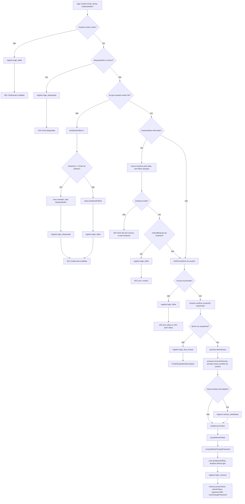

# Fluxograma de função — `AuthService.login`

**Pontos de atenção:**
- A resposta de credenciais inválidas é a mesma para e-mail inexistente e usuário
  inativo — não revela qual condição falhou.
- Expediente é checado **depois** da senha e **depois** de resolver a empresa, por
  design (não dar pista a quem erra a senha; feriado é por empresa).
