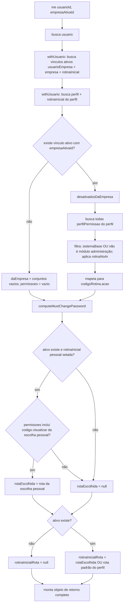

# Fluxograma de função — `AuthService.me`

**Pontos de atenção:**
- Permissões são recalculadas a cada chamada — não reaproveita o conteúdo do JWT,
  então refletem mudanças de perfil/módulo desligado sem exigir novo login.
- A rota inicial pessoal só é honrada se a permissão `.visualizar` correspondente
  ainda existir no momento da chamada; perdê-la temporariamente não apaga a escolha.
