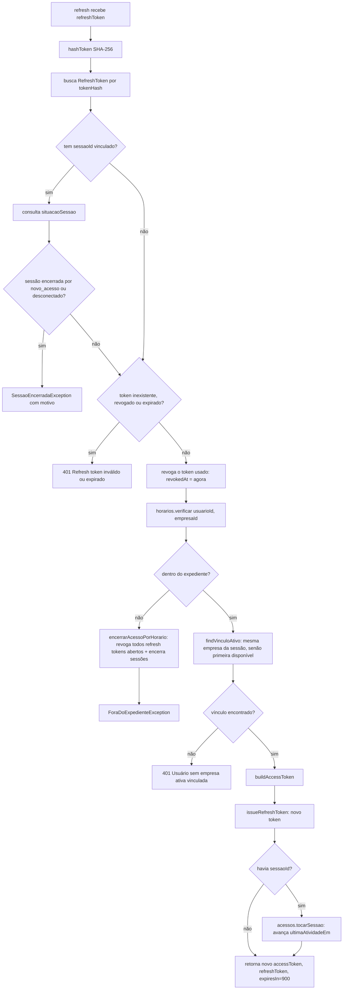

# Fluxograma de função — `AuthService.refresh`

**Pontos de atenção:**
- O token recebido é **sempre** revogado antes de qualquer outra checagem de
  continuidade (expediente) — rotação estrita, nunca reutilizável.
- Esta rota não passa pelo `JwtAuthGuard` (é autenticada pelo próprio refresh token),
  por isso a checagem de expediente é duplicada aqui — sem ela, uma aba deixada aberta
  renovaria o acesso indefinidamente após o fim do expediente.
