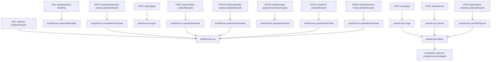

# Fluxograma — Módulo `auth`

> Visão geral das rotas e para onde cada uma leva no service. Fluxogramas por função
> principal estão em arquivos separados (`auth-login.md`, `auth-refresh.md`, etc.).

