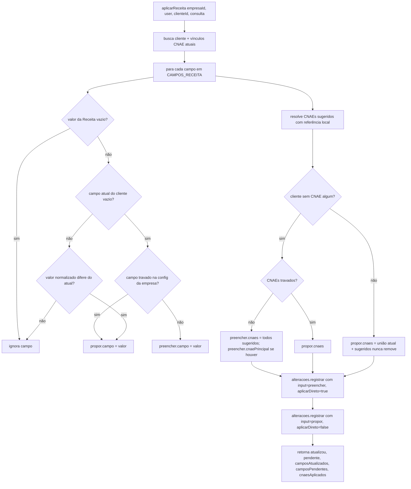

# Fluxograma de função — `ClientesReceitaLoteService.aplicarReceita`

**Pontos de atenção:**
- Mesma função serve a consulta de 1 cliente e o lote — a regra por campo nunca diverge
  entre os dois caminhos.
- CNAE da Receita sem referência local (sync do IBGE atrasado) nunca entra como
  preenchimento ou proposta — vira apenas aviso informativo no retorno.
