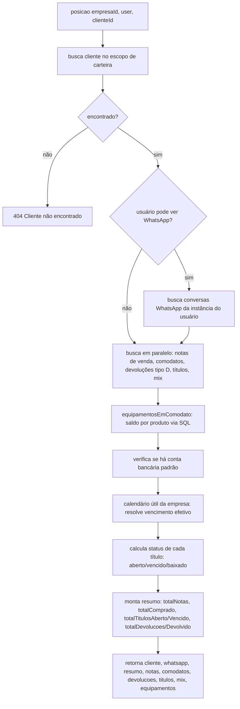

# Fluxograma de função — `ClientesService.posicao`

**Pontos de atenção:**
- Escopo de carteira é verificado **uma única vez**, no cliente; notas/títulos não
  reaplicam o filtro de vendedor (o `vendedorId` de cada nota é "quem executou", não o
  titular da carteira, e não deve restringir a visibilidade de um cliente já autorizado).
- Devolução não abate `totalComprado` — quem abate é o campo `vlrDev` da nota de venda
  original.
