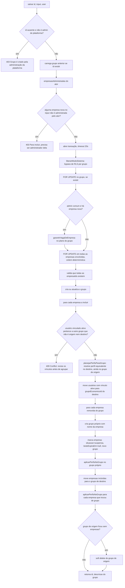

# Fluxograma de função — `GruposEconomicosService.salvar`

**Pontos de atenção:**
- Toda a função roda em modo sistema (bypass de RLS por grupo) — necessário porque a
  operação atravessa múltiplos grupos simultaneamente.
- Locks `FOR UPDATE` seguem ordem determinística (por id) para evitar deadlock entre
  duas recomposições concorrentes que tocam os mesmos registros.
- Nenhuma empresa fica sem grupo ao final — removida do grupo atual sempre ganha um
  grupo próprio.
