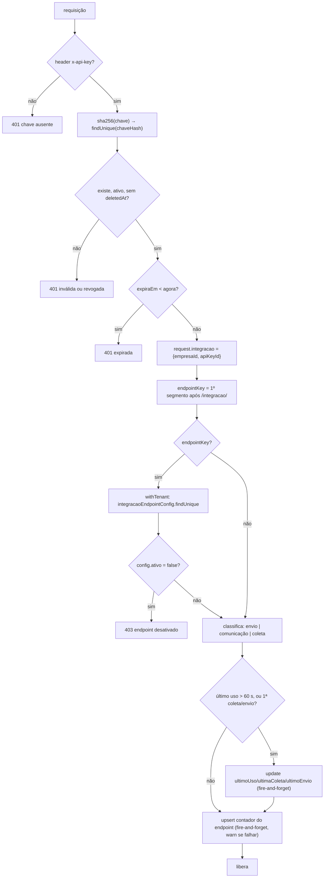

# Fluxograma — `ApiKeyGuard.canActivate`

Classificação: **envio** = `orcamentos/pendentes`, `clientes/alteracoes`,
`equipamentos-comodato/alteracoes`, `arquivo/exportar`; **comunicação** = `/integracao/comunicacao`;
**coleta** = POST/PUT/PATCH/DELETE restantes e `arquivo/importar`.
