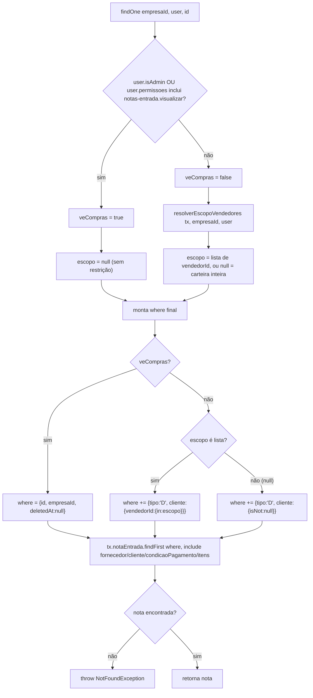

# Fluxograma de função — `NotasEntradaService.findOne`

**Pontos de atenção:**
- A permissão (`RequirePermission` no controller) só decide **se a requisição entra**;
  quem reforça **o que ela pode ver** é este `where` montado no service — sem ele,
  `posicao-cliente.visualizar` sozinho abriria qualquer nota de compra (tipo `'N'`) por
  id, incluindo custo.
- `escopo === null` não significa "sem acesso": significa carteira inteira (vendedor sem
  restrição de hierarquia) — tratado como `cliente.isNot: null`, não como ausência de
  filtro de tipo. `tipo: 'D'` nunca é relaxado por esse ramo.
- Mesmo padrão de dupla porta de acesso existe em `clientes.posicao` (devoluções da
  aba) — este `findOne` é o lado inverso: acessado pelo id da nota, não pelo id do
  cliente.
