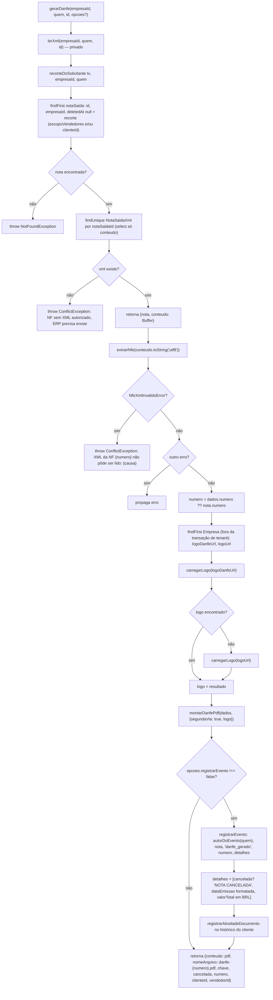

# Fluxograma de função — `NotasSaidaService.gerarDanfe`

**Pontos de atenção:**
- A ordem importa: o evento só é gravado **depois** que o PDF existe (`F18` antes de
  `F19`). Um XML ilegível vira 409 em `F9` e nunca chega a `F19` — o histórico do cliente
  não registra uma 2ª via que ninguém recebeu.
- `F12` (busca da `Empresa` para o logo) roda **fora** da transação `withTenant` usada em
  `lerXml` — `Empresa` não é tabela de tenant (mesmo padrão do PDF de orçamento,
  referenciado no comentário do código).
- `F9`/`F10` distinguem o tipo de erro: só `NfeXmlInvalidoError` vira 409 com mensagem
  amigável citando o número da nota; qualquer outro erro de `extrairNfe` propaga sem
  tratamento especial (bug de parsing legítimo, não XML malformado esperado).
- `opcoes.registrarEvento === false` é usado pelo fluxo de WhatsApp, que grava um evento
  mais específico ("DANFE enviado") em vez de deixar este método gravar "DANFE gerado" —
  evita duplicidade no histórico do cliente para a mesma ação.
- O escopo de acesso inteiro (quem pode chegar a este método) é resolvido **antes** de
  `extrairNfe` sequer rodar, em `lerXml`/`recorteDoSolicitante` — usuário logado e cliente
  via WhatsApp (`QuemPede`) passam pelo mesmo código, cada um com seu recorte.
