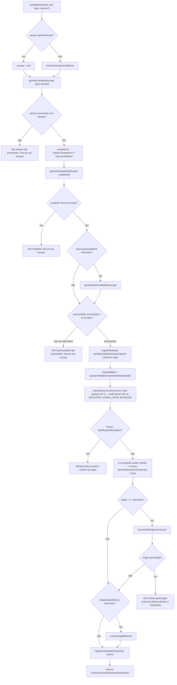

# Fluxograma de função — `OrcamentosService.create`

**Pontos de atenção:**
- `F6`: o `vendedorId` do payload é **descartado** sempre que o cliente já tem vendedor
  cadastrado — o campo só serve de fallback para cliente sem vendedor vinculado. Isto
  significa que o formulário pode mostrar um vendedor e o orçamento gravar outro, se o
  cadastro do cliente mudou entre a abertura do form e o salvar.
- `F12` (`origemDaVenda`) roda **depois** de todas as validações de escopo — ele não pode
  falhar por escopo, só classifica quem está executando.
- `F17`–`F19`: criar já `aprovado` passa pela mesma trava de autorização de desconto que
  a efetivação por `update` — não existe um caminho de criação que pule a checagem.
- Toda a função roda dentro de uma única transação (`withTenant`); a exceção em `F19`
  desfaz a criação do orçamento inteira, incluindo os itens já persistidos em `F16`.
- `F22` sempre executa no caminho feliz, mesmo quando `F20`/`F21` não disparam — todo
  orçamento criado gera pelo menos o evento `criacao` no histórico.
