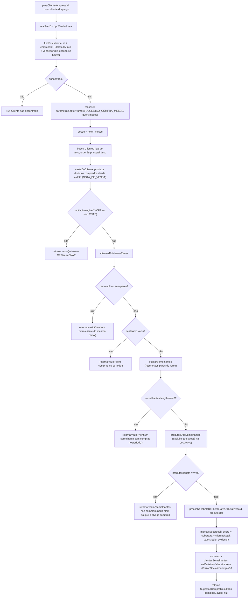

# Fluxograma de função — `SugestaoCompraService.paraCliente`

**Pontos de atenção:**
- Transação com `timeout: 30_000` (30s) — maior que o padrão do Prisma (5s) porque a
  varredura de cesta (`cestaDoCliente`/`buscarSemelhantes`) cruza `notas_saida_itens`, a
  maior tabela da base.
- Cada "retorna vazio" (`V1`–`V5`) é um **diagnóstico diferente**, não uma lista vazia
  genérica — a tela e o agente de IA (consumidor via módulo exportado) mostram a frase
  exata como explicação de por que não há sugestão.
- `F9` (`clientesDoMesmoRamo`) roda **antes** de `F11` (checar se a cesta do alvo está
  vazia): um cliente sem ramo é rejeitado por `F10` mesmo que tenha comprado muito — a
  elegibilidade por CNAE tem prioridade sobre o histórico de compra.
- `F12` (`buscarSemelhantes`) é restrito aos `pares` do ramo (`restringirA`), mas dentro
  deles a busca por semelhança é sobre a **base inteira** desse ramo, não sobre a
  carteira do usuário — é o ponto em que "comparáveis fora da carteira" entram no
  cálculo (ver code-analysis §3.2).
- `F18` é a única barreira de anonimização desta função — ela acontece **depois** que o
  cálculo já usou os ids reais para agregar os produtos (comentário no código: "o cálculo
  acima precisou dos ids reais para agregar; quem está fora da carteira contribuiu para o
  padrão e volta sem identificação").
