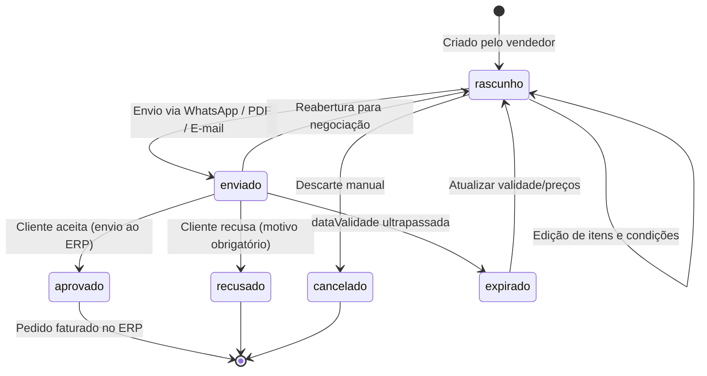
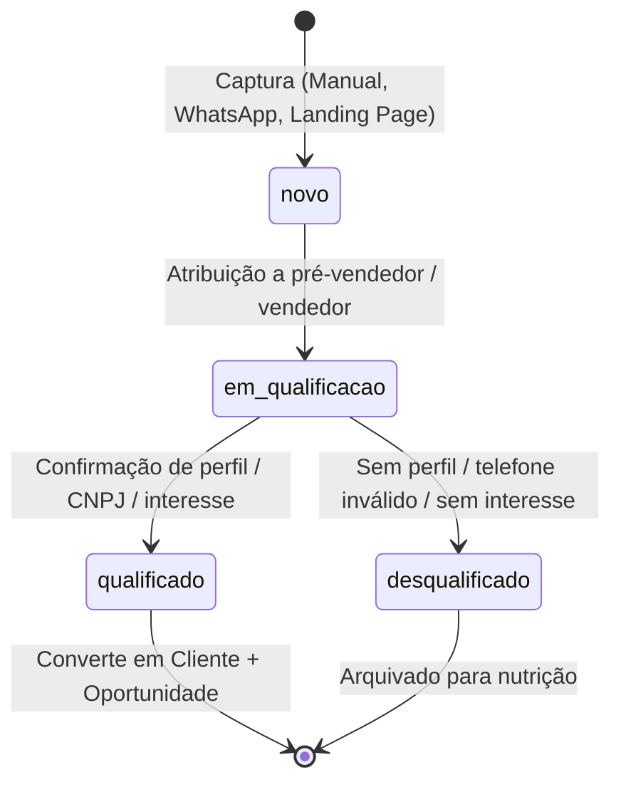
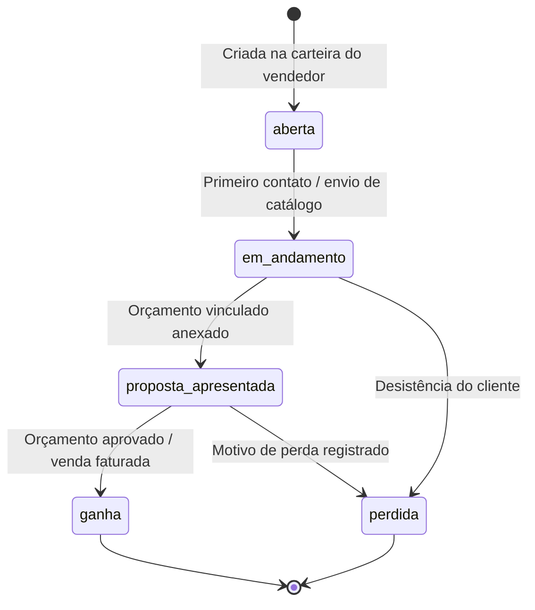
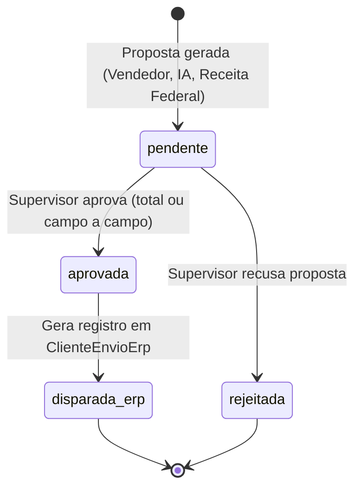
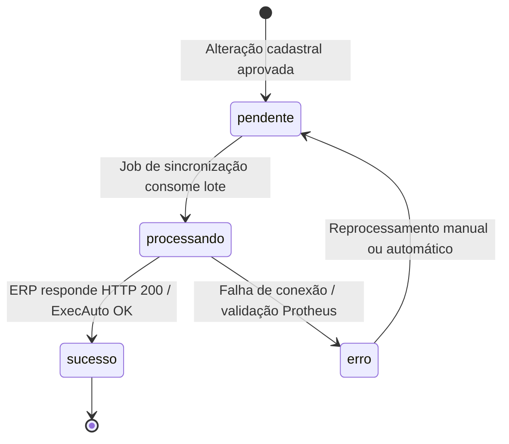
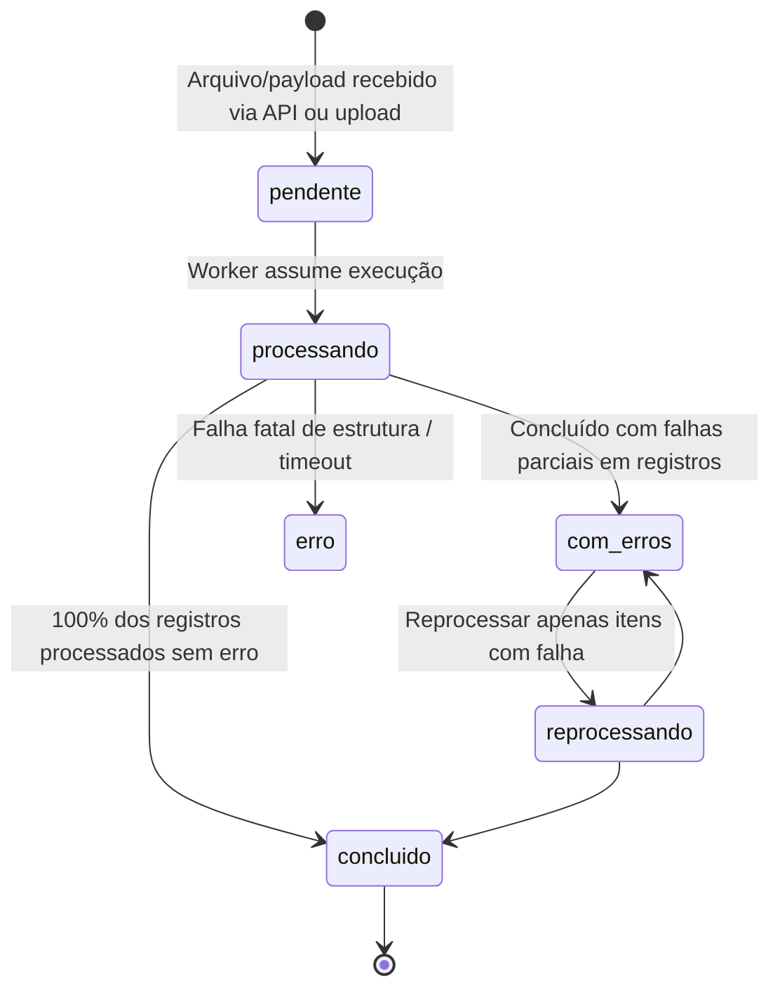
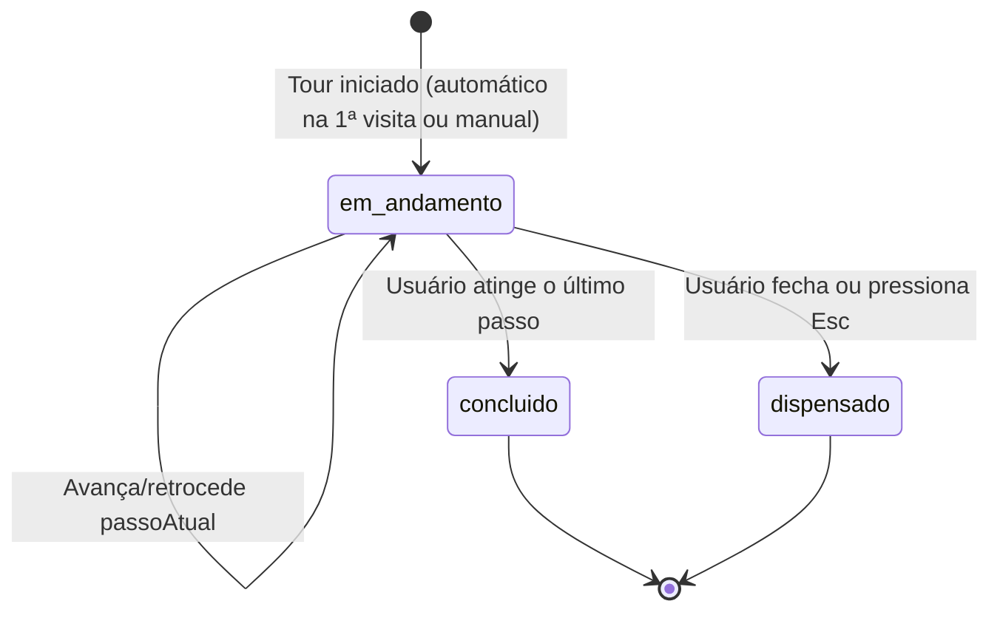
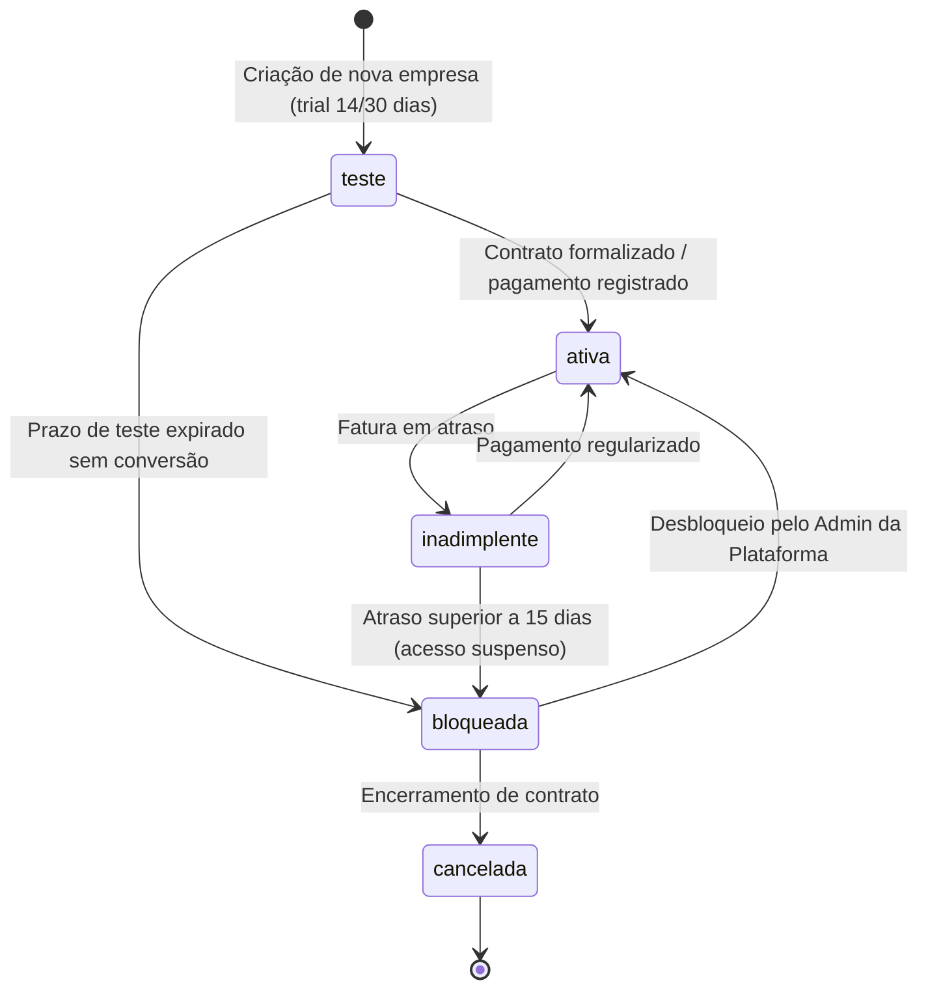

# Máquinas de Estado do Sistema — rcgcba

> Gerado pelo Detective. Nível de documentação: **detalhado**.
> Escala de confiança: 🟢 CONFIRMADO · 🟡 INFERIDO · 🔴 LACUNA

---

## 1. Máquina de Estados: `Orcamento` 🟢

O orçamento comercial representa uma proposta formal de venda emitida pelo vendedor ao cliente.

### Valores de Status (`OrcamentoStatus`)
- `rascunho`: Orçamento em edição pelo vendedor; itens, descontos e prazos podem ser modificados livremente.
- `enviado`: Proposta formalizada e enviada ao cliente via WhatsApp, E-mail ou impressa; bloqueada para edição direta.
- `aprovado`: Proposta aceita pelo cliente; gera envio do pedido ao ERP (criação do pedido de venda SC5/SC6 no Protheus).
- `recusado`: Proposta rejeitada pelo cliente com registro obrigatório de motivo de recusa.
- `expirado`: Atingiu a `dataValidade` sem decisão registrada; bloqueia aprovação sem revalidação de preços.

---

## 2. Máquina de Estados: `Lead` e Funil de Vendas 🟢

O lead representa um contato prospectado antes da formalização do cadastro como cliente ativo.

---

## 3. Máquina de Estados: `Oportunidade` (CRM Pipeline) 🟢

Oportunidades mapeiam negociações de vendas em andamento com clientes da carteira.

---

## 4. Máquina de Estados: `ClienteAlteracao` (Fila de Aprovação) 🟢

Gerencia propostas de atualização de dados cadastrais sensíveis de clientes.

---

## 5. Máquina de Estados: `ClienteEnvioErp` (Sincronização ERP) 🟢

Fila transacional de despacho de atualizações de clientes para o ERP Protheus.

---

## 6. Máquina de Estados: `IntegracaoCarga` (Carga Batch) 🟢

Representa o processamento assíncrono de cargas de dados massivas de produtos, estoque ou clientes.

---

## 7. Máquina de Estados: `TourExecucao` (Onboarding Guiado) 🟢

Registra a experiência do usuário nos tours visuais das rotinas do sistema.

---

## 8. Máquina de Estados: `Assinatura` / `Empresa` (Ciclo SaaS) 🟢

Governa o acesso e as limitações de uso da empresa na plataforma multi-tenant.

